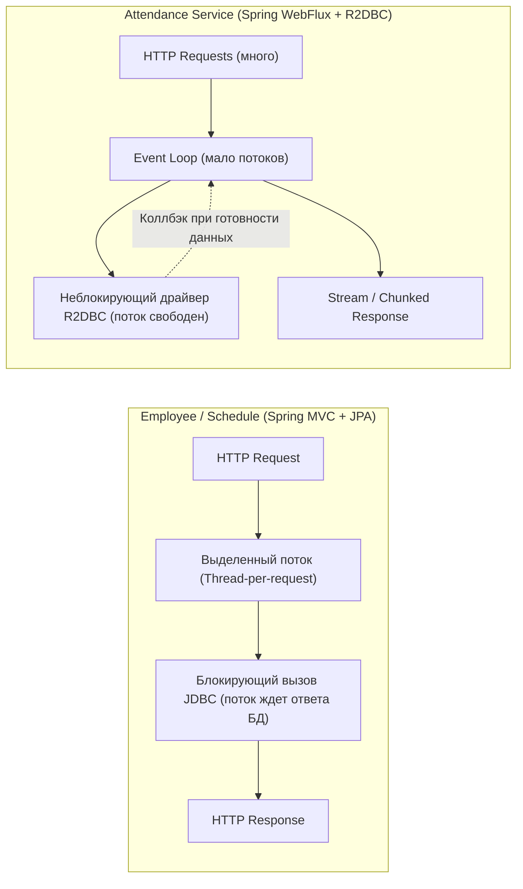
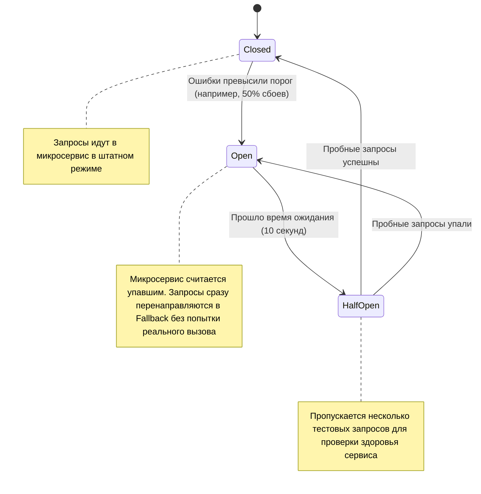

# 🎓 Полное руководство по архитектуре и теории проекта (Лабораторная работа №2 и №3)

---

## 📌 Оглавление
1. [Введение и архитектурный замысел](#1-введение-и-архитектурный-замысел)
2. [Архитектурная схема взаимодействия](#2-архитектурная-схема-взаимодействия)
3. [Карта микросервисов и модулей проекта](#3-карта-микросервисов-и-модулей-проекта)
4. [Словарь аннотаций Spring Framework (что за что отвечает)](#4-словарь-аннотаций-spring-framework)
5. [Реактивный стек vs Классический стек (WebFlux vs WebMvc)](#5-реактивный-стек-vs-классический-стек)
6. [Межсервисное взаимодействие и паттерн Circuit Breaker](#6-межсервисное-взаимодействие-и-паттерн-circuit-breaker)
7. [Пошаговый путь запроса (Life of a Request)](#7-пошаговый-путь-запроса-life-of-a-request)
8. [Шпаргалка к защите: топ-10 каверзных вопросов преподавателя](#8-шпаргалка-к-защите-топ-10-каверзных-вопросов)
9. [Специфика Лабораторной работы №3: Безопасность и JWT](#9-специфика-лабораторной-работы-3-безопасность-и-jwt)

---

## 1. Введение и архитектурный замысел

### Зачем мы перешли от монолита (ЛР1) к микросервисам (ЛР2)?
В первой лабораторной работе система представляла собой **монолит**: единое Spring Boot приложение, где все модули (сотрудники, смены, посещаемость) жили в одном процессе JVM и использовали одну общую базу данных через единый контекст.

**Проблемы монолита:**
- Высокая связанность: падение модуля учета смен приводило к отказу всего приложения.
- Невозможность гибкого масштабирования: если на учет явок приходится 90% нагрузки (например, сотни сканеров пропусков шлют отметки одновременно), масштабировать приходилось весь тяжелый монолит целиком.
- Жесткая привязка к единому стеку технологий (нельзя было легко сделать отдельный сервис реактивным).

**Что сделано в ЛР2:**
Система разбита на **автономные слабосвязанные микросервисы**, каждый из которых решает узкую бизнес-задачу, может развертываться независимо в собственном Docker-контейнере и использовать подходящую парадигму (классическую блокирующую или реактивную неблокирующую).

---

## 2. Архитектурная схема взаимодействия

```mermaid
flowchart TD
    Client["Клиент (Браузер / Swagger / cURL)"]
    
    subgraph Infrastructure ["Инфраструктурный слой"]
        Gateway["API Gateway (:8080)<br/>Spring Cloud Gateway"]
        Eureka["Service Discovery (:8761)<br/>Netflix Eureka"]
        Config["Config Server (:8888)<br/>Spring Cloud Config"]
    end
    
    subgraph BusinessServices ["Бизнес-микросервисы"]
        Employee["Employee Service (:8081)<br/>Сотрудники, филиалы, роли, Security<br/>Spring MVC + JPA + Spring Security"]
        Attendance["Attendance Service (:8082)<br/>Отметки явки, стриминг<br/>Spring WebFlux + R2DBC"]
        Schedule["Schedule Service (:8083)<br/>Графики, смены, заявки<br/>Spring MVC + JPA"]
    end

    subgraph DatabaseLayer ["Слой данных"]
        Postgres[("PostgreSQL 16 (:5432)<br/>portal_db")]
    end

    Client -->|Все HTTP запросы с Bearer JWT| Gateway
    
    Gateway -->|Регистрация и поиск сервисов| Eureka
    Employee -->|Регистрация / Heartbeat| Eureka
    Attendance -->|Регистрация / Heartbeat| Eureka
    Schedule -->|Регистрация / Heartbeat| Eureka

    Employee -.->|Чтение конфигов| Config
    Attendance -.->|Чтение конфигов| Config
    Schedule -.->|Чтение конфигов| Config
    Gateway -.->|Чтение конфигов| Config

    Gateway -->|Маршрутизация /api/employees/**| Employee
    Gateway -->|Маршрутизация /api/attendance/**| Attendance
    Gateway -->|Маршрутизация /api/schedules/**| Schedule

    Schedule -->|OpenFeign + Circuit Breaker| Employee
    Schedule -->|OpenFeign + Circuit Breaker| Attendance

    Employee -->|JDBC / JPA| Postgres
    Attendance -->|R2DBC (Реактивно)| Postgres
    Schedule -->|JDBC / JPA| Postgres
```

---

## 3. Карта микросервисов и модулей проекта

В проекте 8 Maven-модулей в едином реакторе (`pom.xml`):

### 1. `common-dto` (Общая библиотека)
- **Что это:** Общие классы данных (DTO), перечисления (Enums) и вспомогательные структуры.
- **Зачем:** Чтобы сервисы общались на одном языке. В контрактах используются одни и те же DTO (`EmployeeDto`, `AttendanceRecordDto`, `BranchDto`), чтобы избежать дублирования кода.
- **Ключевой класс:** `SliceResponse<T>` — обертка для бесконечной ленты (пагинация «срезами» без тяжелого `COUNT(*)`).

### 2. `discovery-service` (Eureka Server, порт 8761)
- **Что это:** Сервер обнаружения сервисов (Service Discovery).
- **Как работает:** Каждый сервис при старте сообщает Eureka: *"Я — `employee-service`, мой IP такой-то, порт 8081"*. Каждые 30 секунд шлет сердечные ритмы (Heartbeats). Если сервис упал, Eureka убирает его из реестра.
- **Зачем:** Чтобы сервисы не прописывали жестко IP-адреса друг друга (`localhost:8081`), а обращались по логическому имени (`http://employee-service`).

### 3. `config-service` (Config Server, порт 8888)
- **Что это:** Централизованное хранилище конфигураций.
- **Как работает:** Читает YAML-файлы из папки `config-repo/`. Когда любой микросервис поднимается, он первым делом стучится в `config-service` и забирает свои настройки (строки подключения к БД, параметры Circuit Breaker, пулы потоков).

### 4. `gateway-service` (API Gateway, порт 8080)
- **Что это:** Единая точка входа в систему (Reverse Proxy / API Gateway).
- **Обязанности:**
  - Принимает все внешние запросы на порту `8080`.
  - Запрашивает у Eureka адрес нужного сервиса (`lb://employee-service`).
  - Балансирует нагрузку между репликами сервисов (Client-side Load Balancing).
  - Настраивает CORS (Cross-Origin Resource Sharing) для фронтенда.
  - Агрегирует Swagger/OpenAPI документацию со всех сервисов в единый UI.

### 5. `employee-service` (Сотрудники и оргструктура, порт 8081)
- **Технологии:** Spring Web MVC, Spring Data JPA, Hibernate, PostgreSQL JDBC.
- **Зона ответственности:** Компании (`Company`), филиалы (`Branch`), должности (`Position`), сотрудники (`Employee`), пользователи (`User`), роли (`Role`). В ЛР3 сюда добавлена безопасность (JWT, Spring Security).

### 6. `attendance-service` (Реактивный учет посещаемости, порт 8082)
- **Технологии:** Spring WebFlux, Spring Data R2DBC, PostgreSQL R2DBC Driver, Project Reactor (`Mono`/`Flux`).
- **Зона ответственности:** Фиксация прихода/ухода, отслеживание опозданий и переработок.
- **Особенность:** Полностью асинхронный и неблокирующий. Поддерживает потоковую отдачу данных (Server-Sent Events и NDJSON streaming через `Flux`).

### 7. `schedule-service` (Смены, графики и заявки, порт 8083)
- **Технологии:** Spring Web MVC, Spring Data JPA, OpenFeign, Resilience4j Circuit Breaker.
- **Зона ответственности:** Графики работы (`Schedule`), смены (`Shift`), назначение сотрудников на смены (`ShiftEmployee`), заявки на отпуска/отгулы (`Request`).
- **Особенность:** Активно общается с `employee-service` и `attendance-service` через Feign-клиенты.

---

## 4. Словарь аннотаций Spring Framework

### Базовые и инфраструктурные аннотации

| Аннотация | Где пишется | За что отвечает простыми словами |
| :--- | :--- | :--- |
| `@SpringBootApplication` | Главный класс сервиса | Включает автоконфигурацию Spring Boot, сканирование компонентов (`@ComponentScan`) и конфигурацию свойств. |
| `@EnableDiscoveryClient` | Главный класс сервиса | Регистрирует микросервис в Eureka Discovery Server и позволяет искать другие сервисы по их именам. |
| `@EnableConfigServer` | `ConfigServiceApplication` | Превращает приложение в сервер централизованной конфигурации. |
| `@EnableFeignClients` | `ScheduleServiceApplication` | Включает сканирование интерфейсов `@FeignClient` для декларативных HTTP-клиентов. |

### REST & Web контроллеры

| Аннотация | Где пишется | За что отвечает |
| :--- | :--- | :--- |
| `@RestController` | Класс контроллера | Комбинация `@Controller` + `@ResponseBody`. Сообщает Spring, что методы класса возвращают данные прямо в теле HTTP-ответа (в виде JSON), а не HTML-представления. |
| `@RequestMapping("/api/...")` | Над классом / методом | Задает базовый префикс URL-пути для всех эндпоинтов контроллера. |
| `@GetMapping`, `@PostMapping`, `@PutMapping`, `@DeleteMapping` | Над методами | Привязывает HTTP-метод (GET/POST/PUT/DELETE) к конкретному Java-методу. |
| `@PathVariable("id")` | Аргумент метода | Извлекает значение из URL-пути, например: `/api/employees/{id}` -> `Long id`. |
| `@RequestParam` | Аргумент метода | Извлекает query-параметр из строки запроса, например: `/api/employees?page=0&size=20`. |
| `@RequestBody` | Аргумент метода | Преобразует (десериализует) входящий JSON из тела HTTP-запроса в Java-объект DTO. |
| `@ResponseStatus(HttpStatus.CREATED)` | Над методом | Задает HTTP-статус успешного ответа (например, 201 Created вместо дефолтного 200 OK). |

### База данных и ORM (Spring Data JPA)

| Аннотация | Где пишется | За что отвечает |
| :--- | :--- | :--- |
| `@Entity` | Класс доменной модели | Указывает, что класс отображается на таблицу в реляционной базе данных (JPA). |
| `@Table(name = "employees")` | Класс сущности | Задает имя конкретной таблицы в БД. |
| `@Id` | Поле класса | Помечает первичный ключ (Primary Key). |
| `@GeneratedValue(strategy = IDENTITY)` | Поле с `@Id` | Делегирует генерацию первичного ключа столбцу `BIGSERIAL` / `IDENTITY` в Postgres. |
| `@Column(name = "...", nullable = false)` | Поле класса | Настраивает параметры колонки таблицы (имя, обязательность, уникальность). |
| `@Enumerated(EnumType.STRING)` | Поле-enum | Сохраняет значение enum в БД как текстовую строку (например, `'ACTIVE'`), а не как порядковый номер (0, 1). |
| `@ManyToOne(fetch = FetchType.LAZY)` | Поле связи | Связь «многие к одному». `LAZY` означает ленивую загрузку (связанный объект не тянется из БД, пока к нему не обратятся). |
| `@JoinColumn(name = "company_id")` | Поле связи | Указывает имя внешнего ключа (Foreign Key) в таблице. |
| `@Transactional` | Метод или класс сервиса | Открывает транзакцию БД. Если метод выбросит `RuntimeException`, все изменения откатятся (Rollback). Если метод завершится успешно — изменения зафиксируются (Commit). |

> [!TIP]
> **Почему в репозиториях убрали `@Repository`?**  
> Интерфейсы, которые наследуют `JpaRepository` или `R2dbcRepository`, автоматически распознаются Spring Data благодаря механизму компонентного сканирования. Дополнительная аннотация `@Repository` над интерфейсом избыточна.

---

## 5. Реактивный стек vs Классический стек

В нашей системе сосуществуют две разные модели:



### Разница между `Mono` и `Flux`:
- **`Mono<T>`**: Реактивный контейнер, который вернет **0 или 1 элемент** (асинхронный аналог `Optional<T>` или `CompletableFuture<T>`).
  *Пример:* `Mono<AttendanceRecordDto.Response> getById(Long id)` — либо нашли одну запись, либо пустота.
- **`Flux<T>`**: Реактивный контейнер, который отдает **поток от 0 до N элементов** по мере их поступления (асинхронный аналог `List<T>` или `Stream<T>`).
  *Пример:* `Flux<AttendanceRecordDto.Response> stream(...)` — клиенту отдаются записи непрерывным потоком без накопления всего списка в памяти.

### Зачем пагинация срезами (`SliceResponse`) вместо страниц (`Page`)?
- `Page` делает два SQL-запроса: `SELECT ... LIMIT 20 OFFSET 0` **И** тяжелый `SELECT COUNT(*) FROM table`. На миллионах записей `COUNT(*)` убивает производительность.
- `Slice` запрашивает `LIMIT size + 1` (например, 21 запись вместо 20). Если вернулась 21 запись, значит `hasNext = true`, и клиенту отдается 20 записей. `COUNT(*)` не вызывается вообще!

---

## 6. Межсервисное взаимодействие и паттерн Circuit Breaker

Когда `schedule-service` создает смену, ему нужно знать: существует ли сотрудник с ID 5?  
Для этого используется связка **OpenFeign + Resilience4j Circuit Breaker**:

```java
@FeignClient(name = "employee-service", fallback = EmployeeClientFallback.class)
public interface EmployeeClient {
    @GetMapping("/api/employees/{id}")
    EmployeeDto.Response getEmployeeById(@PathVariable("id") Long id);
}
```

### Как работает Circuit Breaker (Предохранитель):



**Что делает Fallback-класс?**  
Если `employee-service` упал, `EmployeeClientFallback` возвращает заглушку:
```java
return EmployeeDto.Response.builder()
    .id(id)
    .name("Резервный профиль (Employee Service временно недоступен)")
    .build();
```
Благодаря этому `schedule-service` не падает с ошибкой 500, а продолжает работу (Graceful Degradation).

---

## 7. Пошаговый путь запроса (Life of a Request)

Рассмотрим, что происходит под капотом при вызове:  
`GET http://localhost:8080/api/employees/1`

1. **API Gateway (порт 8080):**
   - Запрос попадает на Netty-сервер шлюза.
   - Шлюз сопоставляет путь `/api/employees/**` с маршрутом в `application.yaml`:
     `uri: lb://employee-service`.
2. **Eureka Discovery Server (порт 8761):**
   - Шлюз обращается к локальному кэшу реестра Eureka и находит живой инстанс `employee-service` по адресу `172.x.x.x:8081`.
3. **Employee Service (порт 8081):**
   - Запрос приходит в `EmployeeController.getById(1L)`.
   - Контроллер вызывает `EmployeeService.getById(1L)`.
   - Сервис обращается к `EmployeeRepository.findById(1L)`.
4. **PostgreSQL Database:**
   - Hibernate формирует SQL: `SELECT ... FROM employees WHERE id = 1`.
   - Драйвер JDBC возвращает строку данных.
5. **Преобразование и возврат:**
   - Сущность `Employee` мапится в DTO `EmployeeDto.Response`.
   - Контроллер упаковывает DTO в HTTP 200 OK с заголовком `Content-Type: application/json`.
   - Шлюз прозрачно проксирует ответ клиенту.

---

## 8. Шпаргалка к защите: топ-10 каверзных вопросов

### 1. Почему у нас два разных типа взаимодействия с БД (JPA и R2DBC)?
> **Ответ:**  
> JPA (Java Persistence API) — это синхронный блокирующий стандарт для традиционных реляционных БД. Он отлично подходит для сложных сущностей с отношениями (`@ManyToOne`, `@OneToMany`) и транзакционной бизнес-логики (как в `employee-service` и `schedule-service`).  
> R2DBC (Reactive Relational Database Connectivity) — неблокирующий реактивный драйвер. Он использован в `attendance-service`, так как учет явок потенциально генерирует непрерывный высоконагруженный поток событий от турникетов, требующий высокой пропускной способности при минимальном количестве потоков процессора.

### 2. Зачем нам Eureka, если есть Docker Compose (где сервисы и так доступны по имени контейнера)?
> **Ответ:**  
> DNS Docker Compose статичен: он привязан к одному имени контейнера.  
> Eureka — это динамический Service Registry уровня приложения:
> - Поддерживает динамическое масштабирование (горизонтальный скейлинг `docker compose up --scale employee-service=3`). Шлюз автоматически распределит запросы по всем 3 репликам.
> - Отслеживает реальное здоровье приложений через периодические heartbeats (если JVM зависла, Eureka исключит инстанс из маршрутизации, даже если Docker-контейнер еще запущен).

### 3. Чем `Mono` отличается от `Flux`?
> **Ответ:**  
> Оба являются реактивными издателями (Publishers) из библиотеки Project Reactor:
> - `Mono` возвращает максимум один результат: `[0..1]`.
> - `Flux` возвращает последовательность элементов от 0 до бесконечности: `[0..N]`.

### 4. Зачем в реактивном репозитории метод возвращает `Flux`, а не `List`?
> **Ответ:**  
> `List` требует дождаться получения абсолютно всех строк из БД, загрузить их в оперативную память JVM в коллекцию и только потом вернуть.  
> `Flux` отдает каждую строку клиенту сразу по мере ее считывания из сокета базы данных (асинхронный стриминг данных).

### 5. Что такое Circuit Breaker и в каких состояниях он бывает?
> **Ответ:**  
> Паттерн «Предохранитель», предотвращающий каскадное падение микросервисов.  
> Имеет 3 состояния:
> 1. `CLOSED` (закрыт) — всё работает штатно, запросы идут к удаленному сервису.
> 2. `OPEN` (разомкнут) — при превышении процента ошибок (например, >50%) вызовы не отправляются по сети, а сразу отдается fallback-ответ.
> 3. `HALF_OPEN` (полуразомкнут) — спустя таймаут пропускается ограниченная пачка тестовых запросов. Если они успешны — предохранитель закрывается обратно.

### 6. Зачем нужен класс `SliceResponse` и чем `Slice` отличается от `Page`?
> **Ответ:**  
> `Page` выполняет тяжелый подзапрос `COUNT(*)`, чтобы посчитать общее количество страниц.  
> `Slice` запрашивает ровно `size + 1` записей. Если вернулось больше `size`, выставляется флаг `hasNext = true`. Это идеальное решение для бесконечных лент (Infinite Scroll) без деградации базы данных.

### 7. Почему мы убрали `@Repository` из интерфейсов репозиториев?
> **Ответ:**  
> В Spring Data интерфейсы, наследующие `JpaRepository` или `R2dbcRepository`, регистрируются как бины автоматически во время сканирования репозиториев. Явная аннотация `@Repository` является избыточным дублированием.

### 8. Как работает сквозная маршрутизация через API Gateway?
> **Ответ:**  
> В конфигурации шлюза заданы правила предикатов (Predicates) и фильтров (Filters). Если входящий запрос совпадает с шаблоном пути (например, `/api/attendance/**`), шлюз через механизм Service Discovery (`lb://attendance-service`) разрешает актуальный хост и порт и форвардит HTTP-запрос.

### 9. Что делает `@Transactional` при работе с БД?
> **Ответ:**  
> Обеспечивает выполнение требований ACID. Она гарантирует, что группа операций выполнится атомарно: либо все изменения успешно запишутся в базу, либо при возникновении любого необработанного исключения (`RuntimeException`) будет выполнен автоматический откат (`ROLLBACK`).

### 10. Как обеспечивается изоляция данных и тестирование без влияния на прод-базу?
> **Ответ:**  
> Для тестов поднимаются либо in-memory базы (H2), либо временные изолированные контейнеры через библиотеку Testcontainers с чистой схемой, накатываемой скриптами миграций Flyway.

---

## 9. Специфика Лабораторной работы №3: Безопасность и JWT

В `lab3` реализована подсистема аутентификации и авторизации:
1. **JWT (JSON Web Token)**: Клиент отправляет логин/пароль на `/api/auth/login`. Сервер проверяет пароль через BCrypt и возвращает подписанный токен.
2. **Фильтр безопасности (`JwtAuthenticationFilter`)**: Перехватывает каждый входящий HTTP-запрос, извлекает заголовок `Authorization: Bearer <token>`, валидирует цифровую подпись токена и помещает пользователя в `SecurityContextHolder`.
3. **RBAC (Role-Based Access Control)**: Доступ к ресурсам ограничивается ролями (`ROLE_ADMIN`, `ROLE_SUPERVISOR`, `ROLE_EMPLOYEE`). Например, регистрировать новых пользователей могут только супервайзеры и администраторы.
4. **Data Isolation (Изоляция данных)**: Пользователь видит только свои данные (например, свои заявки и смены), если у него нет прав руководителя.
